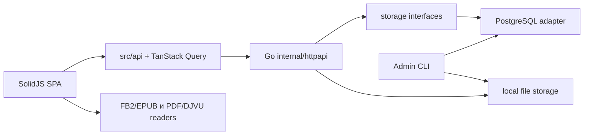

# План системного рефакторинга Book Hub

**Статус:** в работе; этапы 1–2 завершены.
**Последняя верификация исходного состояния:** 2026-07-15.
**Рабочее дерево на момент аудита:** чистое.

## Цель

Повысить сопровождаемость, читаемость, предсказуемость и тестируемость Book Hub без изменения пользовательского и бизнес-поведения.

Рефакторинг должен улучшать глубину внутренних modules: скрывать сложность за небольшими и проверяемыми interfaces, а не добавлять новые слои или обёртки без двух реальных adapters либо иной подтверждённой пользы.

## Границы и запреты

В основной план входят только behavior-preserving изменения:

- сохраняются OpenAPI endpoint-ы, схемы, коды/форматы текущих ответов, cookie и CSRF-поведение;
- сохраняются схема PostgreSQL, миграции, форматы файлов, пути хранения и существующие localStorage-данные;
- не меняются бизнес-инварианты, UX-сценарии, порядок batch-загрузки и возможности читалок;
- не меняются технологический стек и зависимости;
- не выполняются массовое форматирование, несвязанные чистки и переименование файлов ради стиля;
- generated-файл `frontend/src/api/generated/schema.ts` не редактируется вручную;
- документация о текущем поведении меняется только для исправления уже подтверждённого расхождения с кодом.

Перед каждым изменением нужно прочитать `AGENTS.md`, относящиеся к зоне ADR из `docs/adr/`, а при затрагивании предметных терминов — `CONTEXT.md`.

## Краткая карта архитектуры

- `api/openapi.yaml` — источник истины публичного HTTP-контракта.
- `backend/cmd/book-hub-server` собирает config, PostgreSQL adapter, файловое хранилище и `httpapi.Server`.
- `backend/internal/storage/db` и `backend/internal/storage/memory` — два adapters текущего `storage.Store`.
- `frontend/src/api` отвечает за запросы и TanStack Query; страницы и readers используют эти modules.
- PDF/DJVU — фиксированная вёрстка, FB2/EPUB — общий адаптивный pipeline согласно ADR-0003 и ADR-0005.

## Текущее поведение, которое обязательно сохранить

- HTTP: base path, маршрутизация, request ID, JSON ошибок, session/CSRF cookies, ownership-проверки и multipart-поля.
- Библиотека: поиск, фильтры, сортировка relevance, пагинация, cache invalidation и URL list state.
- Загрузка: последовательный batch, частичный успех, глобальная блокировка страницы, отмена поздних результатов подготовки, освобождение preview URL; см. ADR-0001 и ADR-0002.
- Читалки: поиск, оглавление, история браузера, progress, scroll anchors, ширина, расширение страницы, filters, local preferences и освобождение ресурсов PDF/DJVU.
- Хранилище: ownership, теги, progress/`last_opened_at`, сессии, дедупликация, удаление обложек и файлов.
- Локальные preferences: текущая схема `book-hub-preferences`, on-read fallback `readers.pdf` → `readers.fixedLayout`, допустимые значения и sanitization.

## Выявленные проблемные зоны

| Приоритет | Зона | Подтверждённая проблема |
|---|---|---|
| P1 | HTTP backend | `backend/internal/httpapi/server.go` — 1 017 строк; маршруты, middleware, auth, handlers, DTO, responses и lifecycle смешаны в одном module. |
| P1 | Storage | `storage.Store` содержит более 30 методов; DB adapter — 706 строк, memory adapter — 610 строк; `bookQuerier` объявляет `QueryRow`, но использует `Query` через type assertion. |
| P1 | Тесты storage | HTTP-тесты используют только memory adapter; в `backend/internal/storage/db` нет `*_test.go`. |
| P1 | Frontend API | `frontend/src/api/books.ts` — 595 строк и импортирует UI-декодер `Fb2Reader/fb2TextDecoder`, смешивая transport, multipart и cache orchestration. |
| P2 | Fixed-layout readers | `PdfReader.tsx` — 2 032 строки, `DjvuReader.tsx` — 1 292; DJVU импортирует PDF-специфичные styles, filter panel и preferences. |
| P2 | Reflowable readers | `Fb2Reader.tsx` — 1 194 строки; EPUB model повторяет FB2 types и передаётся в `Fb2Reader`. |
| P2 | Upload | `UploadPage.tsx` — 836 строк; UI, async preparation, abort/generation guards, preview URL и batch lifecycle не разделены. |
| P2 | Preferences/tags | `browserPreferences.ts` — 467 и `TagsSelect.tsx` — 737 строк; PDF-термины используются для fixed-layout, `uniqueTags` дублируется в Upload и Library. |
| P2 | Процесс | Покрытие frontend unit-тестов — 10,43%; крупные readers и Upload имеют 0% unit coverage. Единственный workflow — `.github/workflows/publish-images.yml`, он публикует образы по тегу. |
| P3 | Документация | `CONTEXT.md` указывает расширение страницы `0..25%`, код и `docs/APP.md` — `0..80%`; ссылки на `docs/adr/0001-theme-system.md` ведут к отсутствующему файлу. |

Статический анализ локальных TypeScript imports не обнаружил циклов. Это не исключает скрытые runtime-зависимости, но отдельный этап устранения циклов сейчас не требуется.

## Последовательные этапы

### 1. Characterization-тесты и документация

- **Затрагивает:** `backend/internal/httpapi/*_test.go`, frontend unit/E2E tests, `docs/APP.md`, `CONTEXT.md`, theme-комментарии.
- **Изменение:** добавить узкие тесты на уже существующие HTTP-ответы, CSRF, base path, query-cache, upload lifecycle и fixed-layout preferences; исправить только подтверждённые документальные расхождения.
- **Критерий завершения:** тесты фиксируют текущие статусы/тела/cookie, lifecycle черновика и диапазон `0..80`; документация не ссылается на отсутствующий ADR и не противоречит коду.
- **Риски и откат:** риск — неверное characterization-ожидание. Откатить один commit с тестами/docs; production-код не меняется.
- **Зависимости / размер diff:** нет; средний, преимущественно тесты.
- **Проверки:** `git diff --check`, `make backend-test`, `make frontend-unit-test`, `npm --prefix frontend run lint`, `npm --prefix frontend run typecheck`.

### 2. Контрактные тесты storage adapters

- **Затрагивает:** `backend/internal/storage/`, `backend/internal/storage/db/`, test fixtures; при необходимости Makefile и verify workflow.
- **Изменение:** создать общую storage contract-suite для memory и PostgreSQL adapters. Проверить ownership, теги, relevance, progress/`last_opened_at`, обложки, сессии, квоты, удаление и дедупликацию.
- **Критерий завершения:** оба adapters проходят один и тот же набор observable сценариев; PostgreSQL проверяется на реально применённых миграциях.
- **Риски и откат:** тесты могут обнаружить реальное расхождение adapters. Не исправлять его в этом этапе; задокументировать и вынести отдельно. Test-only commit откатывается без миграций.
- **Зависимости / размер diff:** после этапа 1; средний.
- **Непроверенное допущение:** в репозитории отсутствует DB test target. Нельзя считать этап завершённым, пока не будет спроектирован и документирован способ изоляции PostgreSQL. Имя будущей Make-цели и переменных окружения заранее не фиксируется.
- **Проверки:** `make backend-test`; после появления suite — документированная в рамках этапа команда PostgreSQL-тестов; `staticcheck ./...` из `backend/` при наличии инструмента.

### 3. Узкие storage interfaces и локальная чистка backend

- **Затрагивает:** `backend/internal/storage/store.go`, DB/memory adapters, `backend/cmd/book-hub-admin/main.go`.
- **Изменение:** выделить предметные interfaces пользователей, сессий, книг и настроек; сохранить агрегатный compatibility interface для `httpapi.New`. Заменить `bookQuerier` на фактически требуемый минимальный interface. Удалить повторный отзыв сессий в admin CLI после `SetUserActive(..., false)`.
- **Критерий завершения:** DB и memory реализуют прежнее множество операций; HTTP/CLI interfaces и SQL-результаты не меняются; contract-suite проходит.
- **Риски и откат:** неполная группировка методов или неявная зависимость handler-а. Откатить единый commit; schema/API не затрагиваются.
- **Зависимости / размер diff:** зависит от этапа 2; средний.
- **Проверки:** `make backend-test`, PostgreSQL contract-suite из этапа 2, `staticcheck ./...`.

### 4. Декомпозиция HTTP module

- **Затрагивает:** `backend/internal/httpapi/server.go` и новые modules routing, middleware, auth/profile/book handlers, responses/DTO и lifecycle.
- **Изменение:** оставить внешние symbols `New`, `ServeHTTP`, `ListenAndServe` и все маршруты; перенести implementation по cohesive modules без изменения порядка проверок и filesystem cleanup.
- **Критерий завершения:** весь HTTP flow suite остаётся чёрным ящиком и проходит; добавлены table-driven tests для error mapping, request ID, CSRF, multipart и base path.
- **Риски и откат:** изменение порядка middleware, cookie path или cleanup. Один изолированный commit обратим без миграций.
- **Зависимости / размер diff:** зависит от этапов 1–3; средний, преимущественно перенос 1 000+ строк.
- **Проверки:** `make backend-test`, PostgreSQL contract-suite, `staticcheck ./...`.

### 5. Разделение books transport и TanStack Query cache

- **Затрагивает:** `frontend/src/api/books.ts` с выделением transport, query keys и cache updaters; `ReaderPage`; FB2 blob decoder.
- **Изменение:** сделать `books.ts` тонким compatibility facade; удалить зависимость `src/api` от UI module. Сохранить URL, CSRF, query-key значения, multipart-формат и invalidation semantics.
- **Критерий завершения:** unit-тесты покрывают CSRF, multipart, server errors, ordinary/infinite list cache; Library, Upload и Reader E2E не меняют mock-контракты.
- **Риски и откат:** устаревшие данные из-за ошибочной invalidation. Откат одного commit восстанавливает прежний facade.
- **Зависимости / размер diff:** после этапа 1; средний.
- **Проверки:** `make frontend-unit-test`, `npm --prefix frontend run lint`, `npm --prefix frontend run typecheck`, `make frontend-e2e-test`.

### 6. Upload: модель, lifecycle и presentation

- **Затрагивает:** `UploadPage`, `coverExtraction`, новые upload draft model/hook modules, при необходимости отдельный draft-card component.
- **Изменение:** сначала вынести чистые переходы draft state и тесты; затем перенести async lifecycle в hook, оставив странице layout/form. Не заменять текущие статусы новой state machine без доказательства эквивалентности.
- **Критерий завершения:** сохранены последовательность batch, частичный успех, global page lock, abort/generation guards, preview URL cleanup и поведение ошибок из ADR-0001/0002.
- **Риски и откат:** поздние async results, двойной unlock, утечка URL. Делить на два revertible commits: model и hook/presentation.
- **Зависимости / размер diff:** зависит от этапа 5; два малых/средних diff.
- **Проверки:** `make frontend-unit-test`, `npm --prefix frontend exec playwright test tests/upload.spec.ts`, lint, typecheck.

### 7. Tags: общие правила и декомпозиция control

- **Затрагивает:** `TagsSelect`, Upload/Library pages, новые tag utilities и component tests.
- **Изменение:** вынести единые merge/normalization helpers; затем отделить async selection model от overflow presentation.
- **Критерий завершения:** unit-тесты на dedup/order/recent tags/stale requests; component tests на Enter, arrows, double Backspace, collapsed tags и disabled state.
- **Риски и откат:** keyboard flow и ширина layout. Два небольших независимых commits можно откатить отдельно.
- **Зависимости / размер diff:** после этапа 1; два малых diff.
- **Проверки:** `make frontend-unit-test`, lint, typecheck, `make frontend-e2e-test`.

### 8. Preferences и fixed-layout terminology

- **Затрагивает:** `browserPreferences`, PDF/DJVU readers, preference tests.
- **Изменение:** перевести PDF caller на существующие `get/setFixedLayout…`; разнести JSON access/migration, UI preferences, reflowable и fixed-layout preferences по modules.
- **Критерий завершения:** fixtures для пустого, повреждённого, legacy `readers.pdf` и `readers.fixedLayout` дают те же значения; schema/version и fallback не меняются.
- **Риски и откат:** это локальная data-migration на чтении. Не удалять legacy fallback в рамках этого плана; откатить изолированный commit при несовпадении fixture.
- **Зависимости / размер diff:** после этапа 1; средний.
- **Проверки:** `make frontend-unit-test`, lint, typecheck, `make frontend-e2e-test`.

### 9. Fixed-layout foundation

- **Затрагивает:** PDF/DJVU shared helpers, filters, filter panel, styles и fixed-layout preferences.
- **Изменение:** извлечь стабильные чистые geometry/filter/preference modules и переименовать PDF-специфичные общие сущности в fixed-layout. Не вводить универсальный renderer на этом этапе.
- **Критерий завершения:** unit-тесты геометрии, clamp, filter order и preferences; PDF/DJVU сохраняют DOM/UI для ширины, overflow и filters.
- **Риски и откат:** ошибочная переадресация imports/CSS. Откат без смены localStorage schema.
- **Зависимости / размер diff:** зависит от этапа 8; средний.
- **Проверки:** `make frontend-unit-test`, lint, typecheck, `make frontend-e2e-test`.

### 10. Общий fixed-layout reader с двумя adapters

- **Затрагивает:** новые `FixedLayoutReader` и PDF/DJVU adapters; существующие reader components.
- **Изменение:** после foundation создать общий глубокий module с малым adapter interface: document lifecycle, pages, render/release, search, outline и navigation. PDF и DJVU мигрировать отдельными commits.
- **Критерий завершения:** adapter contract tests с fake document; реальные E2E PDF/DJVU для поиска, оглавления, истории, ширины/overflow, filters, horizontal scroll и unmount cleanup.
- **Риски и откат:** scroll anchors, virtual rendering, text layers, canvas/worker cleanup. Это architectural migration; откатывать по одному adapter commit.
- **Зависимости / размер diff:** зависит от этапов 1, 8, 9; большой.
- **Проверки:** `make frontend-test`, `make frontend-build`, затем `make test`.

### 11. Нейтральный reflowable reader

- **Затрагивает:** `Fb2Reader`, `EpubReader`, FB2/EPUB types, parser adapters и presentation modules.
- **Изменение:** выделить `ReflowableReader` и нейтральный document model; FB2/EPUB оставить format adapters. Переходить через type aliases, затем implementation, затем удаление compatibility aliases.
- **Критерий завершения:** parser fixtures, unit-тесты границ и E2E FB2/EPUB для поиска, оглавления, сносок, progress и settings сохраняют результаты.
- **Риски и откат:** широкая TypeScript-миграция и отличия virtual layout. Это architectural migration; каждый из трёх подэтапов должен быть отдельным commit.
- **Зависимости / размер diff:** зависит от этапа 1; большой, независим от fixed-layout migration.
- **Проверки:** `make frontend-test`, `make frontend-build`, `make test`.

### 12. Постоянный quality gate

- **Затрагивает:** новый `.github/workflows/verify.yml`, возможно Makefile и `DEV.md`.
- **Изменение:** не менять существующий `publish-images.yml`; добавить workflow проверки на push/PR с Go tests, frontend lint/unit/typecheck/build, OpenAPI generation cleanliness, Playwright и PostgreSQL suite после её появления.
- **Критерий завершения:** workflow использует проверенные локальные команды, сохраняет Playwright artifacts при сбое и не публикует образы.
- **Риски и откат:** увеличение времени CI. Разделить jobs и использовать cache; workflow обратим отдельным commit.
- **Зависимости / размер diff:** зависит от этапов 2 и 5; средний.
- **Проверки:** `make test`, `npm --prefix frontend run lint`, `npm --prefix frontend run typecheck`; `make frontend-generate` и `git diff --exit-code` только в job проверки generated API types.

## Общий критерий завершения

Рефакторинг считается завершённым, когда все выбранные этапы отмечены в `Progress`, их критерии завершения выполнены, актуальные docs не противоречат коду, полный `make test` проходит, и нет неподтверждённых поведенческих изменений в HTTP, localStorage, upload lifecycle и обеих группах читалок.

## Progress

- [x] 1. Characterization-тесты и документация
- [x] 2. Контрактные тесты storage adapters
- [ ] 3. Узкие storage interfaces
- [ ] 4. Декомпозиция HTTP module
- [ ] 5. Books transport и query-cache
- [ ] 6. Upload model/lifecycle/presentation
- [ ] 7. Tags utilities и control
- [ ] 8. Preferences и fixed-layout terminology
- [ ] 9. Fixed-layout foundation
- [ ] 10. Общий fixed-layout reader
- [ ] 11. Нейтральный reflowable reader
- [ ] 12. Quality gate

## Decisions

- **Подтверждено:** основной план сохраняет пользовательское и бизнес-поведение; P0 hardening не смешивается с refactor-only PR.
- **Подтверждено:** API, migrations, зависимости и форматы данных не меняются в этапах 1–12.
- **Подтверждено:** interfaces оправданы только там, где есть два реальных adapters — DB и memory storage, PDF и DJVU reader adapters.
- **Подтверждено:** существующий on-read fallback `readers.pdf` → `readers.fixedLayout` сохраняется в refactoring scope.
- **Подтверждено (этап 1, 2026-07-16):** CSRF cookie сохраняет configured base path, а успешные и ошибочные HTTP-ответы несут `X-Request-Id`; unprefixed API path при размещении в подпапке остаётся недоступным.
- **Подтверждено (этап 1, 2026-07-16):** localStorage fallback `readers.pdf` → `readers.fixedLayout` переносит существующие значения при чтении; диапазон расширения страницы остаётся `0..80`.
- **Подтверждено (этап 2, 2026-07-16):** PostgreSQL contract-suite использует `BOOK_HUB_TEST_DATABASE_URL`, создаёт случайную schema, применяет к ней фактические миграции через `search_path` и удаляет schema в cleanup; public schema и данные не затрагиваются.
- **Непроверенное предположение:** внешний пользователь не зависит от недокументированного admin CLI output или внутренних frontend localStorage details помимо уже описанной схемы.

## Discoveries

- Backend имеет 23 Go-файла и 9 test-файлов; DB adapter не покрыт отдельными тестами.
- Frontend содержит 105 TypeScript/TSX source files, 8 unit test files, 6 Playwright spec files и 16 Storybook stories.
- 2026-07-15 успешно прошли `make backend-test`, `staticcheck ./...`, frontend lint, unit-тесты и typecheck.
- Frontend unit coverage: statements 10,43%, branches 12,47%, functions 9,84%, lines 11,30%.
- Локальных TypeScript import cycles в статическом графе не обнаружено.
- В Makefile существуют `backend-test`, `storage-contract-test`, `frontend-unit-test`, `frontend-e2e-test`, `frontend-test`, `frontend-generate`, `frontend-build`, `test`; `storage-contract-test` требует отдельный PostgreSQL URL.
- Этап 1 (2026-07-16): добавлены characterization-тесты HTTP CSRF/base path/request ID, frontend API base path и ordinary/infinite query cache, legacy fixed-layout preferences и частичного upload batch. `CONTEXT.md` исправлен на диапазон `0..80`; из документации и theme-комментариев удалены ссылки на отсутствующий ADR темы.
- Этап 1 (2026-07-16): успешно прошли `git diff --check`, `make backend-test`, `make frontend-unit-test` (9 файлов, 30 тестов), `npm --prefix frontend run lint`, `npm --prefix frontend run typecheck` и дополнительно `npm --prefix frontend exec playwright test tests/upload.spec.ts` (2 теста). Lint завершился с кодом 0; единственное предупреждение относится к игнорируемому coverage-артефакту `frontend/coverage/block-navigation.js`.
- Этап 2 (2026-07-16): общая contract-suite проходит для memory adapter и для PostgreSQL adapter на реально применённых миграциях в отдельной случайной schema. Документированная Make-цель требует `BOOK_HUB_TEST_DATABASE_URL`; локальный PostgreSQL текущего compose-стека доступен только из Docker network, поэтому фактический запуск выполнен в Go 1.26 container в этой сети.
- Этап 2 (2026-07-16): suite проверяет ownership, нормализацию и выборку тегов, relevance после progress/`last_opened_at`, обложки, сессии, квоты, пользовательскую дедупликацию и удаление последней файловой ссылки. Успешно прошли `git diff --check`, `make backend-test`, PostgreSQL contract-suite на Go 1.26 и `staticcheck ./...` на Go 1.26. Локальный staticcheck собран под Go 1.24 и не совместим с модулем Go 1.26.

## Blockers

- Нельзя установить по коду, есть ли внешние потребители недокументированных HTTP-деталей, localStorage keys или вывода admin CLI.
- Для acceptance renderer/refactor нужны реальные PDF, DJVU, FB2 и EPUB fixtures, включая проблемные пользовательские книги; текущие mocked E2E этого не доказывают.
- Политика CI неизвестна: нужно подтверждение, обязателен ли Playwright/PostgreSQL job на каждом PR или только на protected branches.
- Этап 1 (2026-07-16): новых блокеров не выявлено.
- Этап 2 (2026-07-16): новых блокеров не выявлено.

## Deferred work

Следующие проблемы подтверждены, но **не входят** в behavior-preserving refactoring. Каждая требует отдельного решения о допустимом изменении поведения, contract tests и при необходимости миграционного плана:

- атомарность конкурентной дедуплицированной загрузки и проверка квоты в той же DB transaction;
- recovery/reconciliation согласования PostgreSQL и filesystem;
- серверная валидация содержимого EPUB/DJVU;
- fail-fast config parsing;
- исправление OpenAPI `BookQueryRequest.limit: 0` и добавление `service_unavailable` в error enum;
- ограничение cache крупных Blob и перенос тяжёлого EPUB parsing в Worker.

Эти пункты отражены в `REFACTOR_TODO.md`, но не должны включаться в refactor-only PR без явного согласования.
